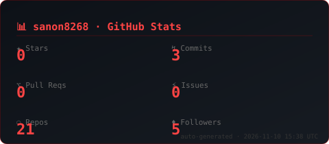
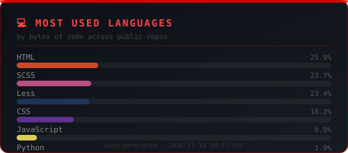

<!-- Header (static SVG in repo — never breaks) -->
<div align="center">
  
</div>

<br/>

---

<!-- Terminal About -->
```bash
┌──(kali㉿kali)-[~]
└─$ whoami
  > Red Team Enthusiast | Offensive Security | CTF Addict

┌──(kali㉿kali)-[~]
└─$ cat skills.txt
  ✦ Adversary Simulation & Penetration Testing
  ✦ Active Directory
  ✦ Web Exploitation
  ✦ Malware Development  ·  Security Automation
  ✦ Cloud & Network Security  ·  OSINT & Recon

┌──(kali㉿kali)-[~]
└─$ cat status.txt
  ⚡ Currently  : Building toward Red Team Operator
  🚩 CTF        : TryHackMe | HackTheBox
```

---

## 📊 Stats - self-generated, no third parties

<table width="100%" align="center">
  <tr>
    <td width="50%" align="center">
      
    </td>
    <td width="50%" align="center">
      
    </td>
  </tr>
</table>

---

## 🐍 Contribution Snake

<div align="center">
  
</div>

---

## 💻 Tech Stack


---

## 🎯 Attack Surface

<div align="center">

| Domain | Tools | Status |
|--------|-------|--------|
| 🌐 Web App | Burp Suite · SQLMap · ffuf | ✅ Active |
| 🏰 Active Directory | BloodHound · CrackMapExec · Impacket | ✅ Active |
| 📡 Network | Nmap · Wireshark · Responder | ✅ Active |
| ☁️ Cloud | AWS · Azure AD · Pacu | 🔄 Learning |
| 🦠 Malware Dev | C/C++ · Python · msfvenom | 🔄 Learning |
| 🔴 C2 Frameworks | Cobalt Strike · Havoc · Sliver | 🔄 Learning |

</div>

---

## 🚩 CTF & Labs

<div align="center">

[](https://tryhackme.com/p/sanon8268)
[](https://app.hackthebox.com/profile/)


</div>

---

## 📚 Currently Studying

```
[▓▓▓▓▓▓▓▓▓░] 85%  Active Directory Attacks
[▓▓▓▓▓▓▓░░░] 70%  Web Application Exploitation  
[▓▓▓▓▓░░░░░] 50%  Malware Development (C/C++)
[▓▓▓▓░░░░░░] 40%  EDR Evasion Techniques
[▓▓░░░░░░░░] 20%  C2 Framework Development
```

---

<div align="center">
  
</div>
